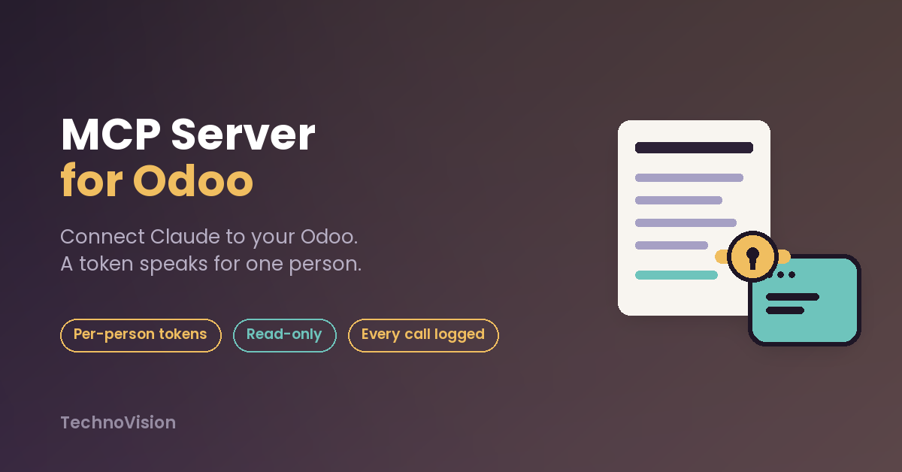
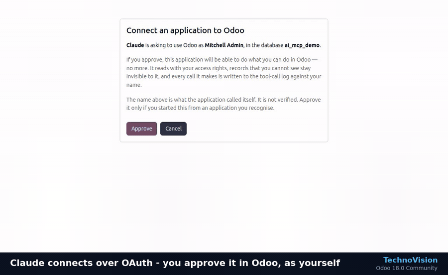
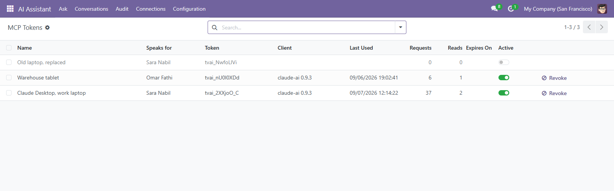
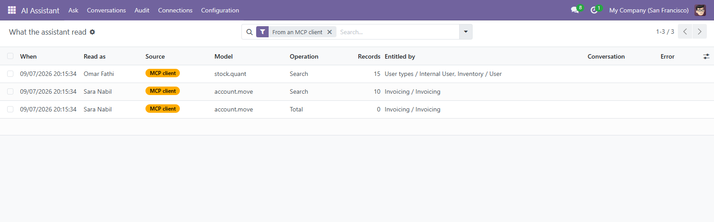

# Claude Connector for Odoo: a permission-aware MCP server

Connect **Claude** (web, desktop or mobile) and other MCP clients to your **Odoo 18 or 19** database, without
handing over an admin key.

This module turns your Odoo into a remote **Model Context Protocol (MCP) server**. Claude connects with
**OAuth 2.1** in two clicks. Every request runs **as one named Odoo user**, with that user's access rights, so
the AI sees exactly what that person could see in Odoo. No more.

## Why it's different

| | Typical "AI for Odoo" setup | Claude Connector for Odoo |
|---|---|---|
| Identity | One admin API key for everyone | Each token or OAuth grant acts as **one person** (`with_user`) |
| What the AI can see | Everything | Only what that user's groups and record rules allow |
| Writes | Direct | **Off by default.** Enabled per model and per field, and by default each write is a **proposal a person approves** in Odoo |
| Audit | None | Every call is logged with user, token, client name and source |
| Connecting Claude web and mobile | Config file on one desktop | **OAuth 2.1** (RFC 9728 / 8414 / 7591, PKCE S256) |

## Features

- **Remote MCP endpoint** (`/mcp/v1`, JSON-RPC 2.0): `initialize`, `tools/list`, `tools/call`, `ping`
- **OAuth 2.1 for Claude**: protected-resource and authorization-server metadata, dynamic client registration,
  authorization code + PKCE S256 only, rotating refresh tokens, an approval screen served by Odoo
- **Per-person tokens** for desktop clients: shown once, stored only as a SHA-256 digest, with expiry and
  one-click revocation
- **Tools scoped per request**: `tools/list` returns only what that person can reach
- **Models exposed by allow-list**: nothing is exposed until an administrator names the models
- **Approval workflow for writes**: create, update and delete are proposals unless an administrator decides
  otherwise for a named model
- **Full audit trail**: MCP reads and writes appear next to reads made inside Odoo
- Odoo **18.0 and 19.0**, Community and Enterprise, Odoo.sh or self-hosted

## Connect Claude in two clicks

1. Install the module on your Odoo (HTTPS required).
2. In Odoo, open **AI Assistant → Connections** and choose which models to expose.
3. In Claude, go to **Settings → Connectors → Add custom connector** and paste your Odoo MCP URL
   (`https://your-odoo.example.com/mcp/v1`).
4. Approve the connection on the Odoo screen that opens. Claude now answers from your Odoo data, as you.

Desktop clients that use a config file get a ready-made JSON block from the token wizard.

## Get it

The module is published on the official **Odoo Apps Store**:

- Odoo 19.0: https://apps.odoo.com/apps/modules/19.0/technovision_ai_mcp/
- Odoo 18.0: https://apps.odoo.com/apps/modules/18.0/technovision_ai_mcp/

It requires *AI Assistant for Odoo — Permission-Aware* (`technovision_ai_core`), which the store installs
with it.

Product page and documentation: https://technovision.dev/products/mcp-server

## Need it set up?

We install and configure it on your database, including Odoo.sh, and can build a custom tool for one of your
workflows. Contact **info@technovision.dev**.

---

This repository is the public information page for the connector. The module itself is licensed under OPL-1
and distributed through the Odoo Apps Store.

**TechnoVision** · [technovision.dev](https://technovision.dev)
